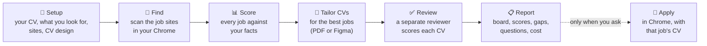
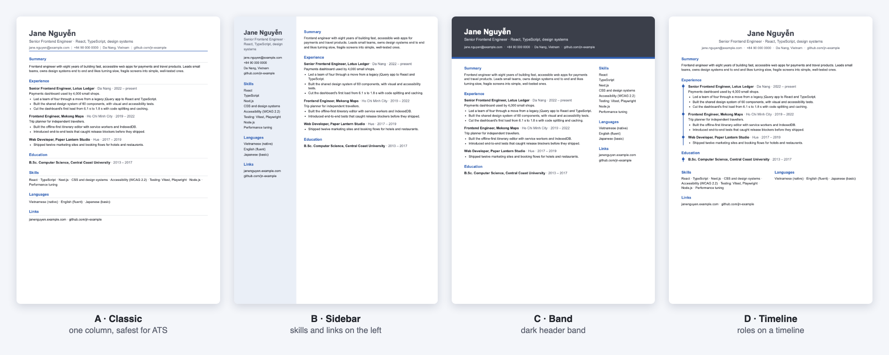

<p align="center">
  
</p>

<p align="center">
  <a href="https://github.com/bason-labs/bs-job-kit/releases/latest"></a>
  
  
  
</p>

Ask Claude (or Codex) in this folder to **find jobs**. It scans the job sites in your Chrome, scores every relevant job against your facts, makes a tailored CV for the best ones, has a separate reviewer score each CV, and reports back. No app, no server, nothing to host: everything is plain files you can read.

## ✨ What it does



| Why trust it | How |
|---|---|
| 🧾 **Only your facts** | CVs use nothing but what is in `master-cv.yaml`. A requirement your facts lack becomes a question, never a claim. |
| 🎯 **Scored, with reasons** | Each job gets a fit score from `criteria.md`, with the reason for every point and the gaps it found. |
| 🧑‍⚖️ **A second opinion on every CV** | A fresh reviewer checks keywords, format and truth, and fails any invented claim. |
| 🌍 **Any language, any country** | Ask in your own words; CVs in the languages you choose. |
| 💸 **Cost you can see** | Tokens and cost per run and per role in `cost.md`. |

## 🎨 CV designs

Pick a built-in layout in setup, copy a design you already have, or use your own Figma file.

<p align="center">
  
</p>

Classic reads best for automatic CV screening; the others suit CVs sent to a person. More in [`templates/cv/README.md`](templates/cv/README.md).

## 🚀 Start

Works on macOS and Windows.

1. **Download** the [latest release](https://github.com/bason-labs/bs-job-kit/releases/latest) for your computer: `macos-apple-silicon` (M1 and later), `macos-intel`, or `windows-x64`, and unzip it. The folder holds the program `bs-job` (`bs-job.exe` on Windows) and readable files. The first time only:
   - **macOS:** the program is not signed by Apple. In a terminal in the folder run `xattr -dr com.apple.quarantine .` once, or macOS blocks it.
   - **Windows:** if SmartScreen warns about `bs-job.exe`, choose **More info**, then **Run anyway**.
2. **Install** Git and Chrome (or Edge). Node is not needed to use a release.
3. **Open Claude Code in the folder** (`cd bs-job-kit`, then `claude`). Start it inside the folder, or the session misses `.mcp.json`. Accept the trust prompt once, so `.claude/settings.json` applies. (Codex: `codex` in the same folder; it does what its tools allow and says what it skipped.)
4. **Connect Claude in Chrome**, so the job sites you are logged in to can be read.
5. **Figma desktop** is needed only if you choose the Figma route for CVs: open your CV file and start **Plugins, Development, Figma Desktop Bridge**. The default route makes PDFs with Chrome and needs no Figma. On **Windows**, the Figma server in `.mcp.json` must start through `cmd`: replace its entry with `"command": "cmd", "args": ["/c","npx","-y","figma-console-mcp@1.40.9"]`.

### First use

Say anything, for example "find jobs". The first time, Claude runs [setup](.claude/skills/job/references/setup.md): it asks for your CV or the job title you want, what you look for, which job sites to use and how your CVs should look, one question at a time, and writes it all into `master-cv.yaml`, `profile.yaml` and `criteria.md`.

## 💬 Ask

| You say | It does |
|---|---|
| "find frontend React jobs in Berlin" | scans, scores and stores every relevant job, makes up to 3 CVs, reports |
| "status" | the board by status |
| "list the jobs below threshold" | jobs under the threshold with their scores and gaps |
| "make a CV for the Acme job" | tailors, exports and evaluates a CV for that job |
| "I applied to the Acme job" / "skip job X" | moves the job on the board |
| "apply to the Acme job for me" | applies in Chrome with that job's PDF, only that job |
| "raise the job match weight to 50" / "threshold 70" / "make 5 CVs per run" | edits `criteria.md` / `profile.yaml` |
| "I have 2 years of AWS at my old company" | adds the fact to `master-cv.yaml` and says so |
| "cost" | cost per run and per role |
| "tìm job frontend React ở HCM" | any language works: this one finds frontend React jobs in Ho Chi Minh City |

> [!NOTE]
> Runs never stop to ask: a guess is written to `context/Q-n.md` and listed in the report, and you answer it any time in plain words. Applying is the exception: it asks first.

### What a run gives you

```text
# find frontend React jobs in Berlin

## Ready for you
| Job                                   | Fit | CV | PDF        |
|---------------------------------------|-----|----|------------|
| Acme · Senior Frontend Engineer        |  84 | 86 | cv-en.pdf  |
| Nimbus · React Developer (Remote, EU)  |  77 | 81 | cv-en.pdf  |

## Also found
6 below threshold (best: Orbit · Frontend Engineer, 58), 11 already known.

## Guesses and questions
Q-3: Have you used GraphQL? Where?   (taken: left off the CV)
```

<sub>An example of the report's shape, not real jobs.</sub>

## 🗂 Where things are

| Path | What you check there |
|---|---|
| `jobs/index.md` | the board: ready, below threshold, applied, skipped, CV failed |
| `jobs/<id>/` | one job: JD, fit score and gaps, CV evaluation, `cv-<lang>.pdf`, apply evidence |
| `master-cv.yaml` | your facts; CVs use nothing else |
| `profile.yaml` | what you look for, threshold, CVs per run, sources, CV route and layout |
| `criteria.md` | how jobs and CVs are scored, with versions and a change log |
| `context/` | what was learned or said: environment, notes, open questions |
| `references/` | your words as given |
| `reports/` | one report per run |
| `logs/`, `cost.md` | tokens and cost per run and per role |

## 🤝 Share it

Give someone the release zip for their computer, untouched. A folder you have already run setup in carries your facts, jobs and CVs.

<details>
<summary><b>🧪 Check a release</b></summary>

On a new computer, before the first search:

1. In the folder: `./bs-job version` (macOS) or `.\bs-job.exe version` (Windows) prints the version.
2. `./bs-job cv-pdf --data templates/cv/sample.json --out $TMPDIR/test.pdf` (Windows: `.\bs-job.exe cv-pdf --data templates\cv\sample.json --out %TEMP%\test.pdf`) writes a one-page PDF.
3. Start `claude` in the folder and say "find jobs": it begins setup.

</details>

<details>
<summary><b>🛠 Develop (source checkout)</b></summary>

Needs Node 22+; building releases also needs [Bun](https://bun.sh).

```
npm test          # node --test, no dependencies
npm run check     # leftover wording, owner wording, frontmatter, broken links
npm run release   # compiles bin/ into bs-job for macOS (Apple, Intel) and Windows, writes release/*.zip
```

In a source checkout the skill's `bs-job <command>` runs as `node bin/bs-job.mjs <command>`.

</details>

## License

[MIT](LICENSE)
